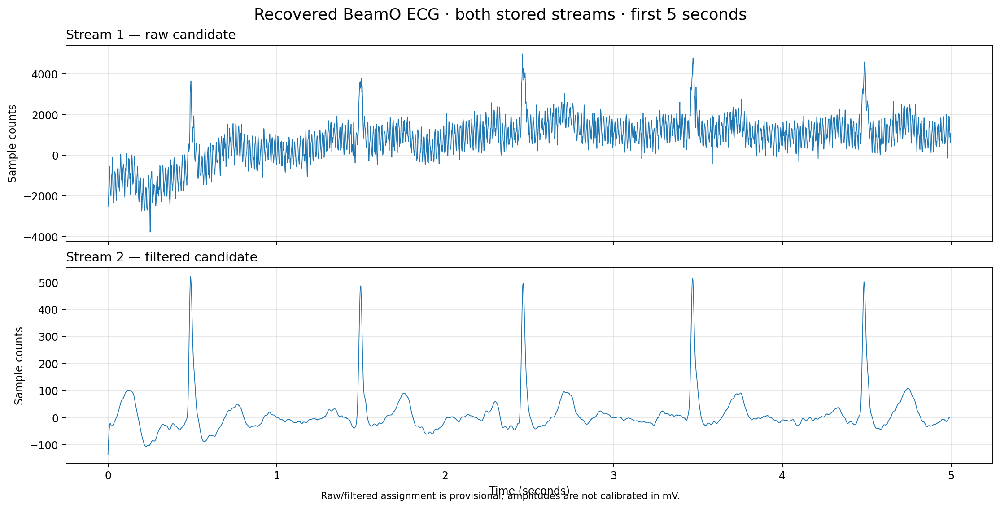
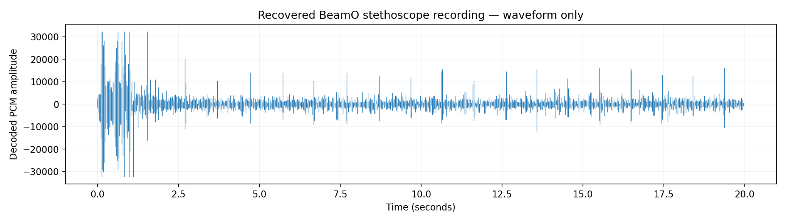

# Withings BLE Protocol Study

**Independent research into the Bluetooth Low Energy protocols used by Withings health-monitoring devices.**

This repository documents an educational investigation into how Withings devices communicate over Bluetooth Low Energy (BLE), including device discovery, authentication, provisioning, user configuration, measurement retrieval, and binary signal transfers.

The objective is to document observed protocol behavior and provide enough technical information for other developers and researchers to reproduce, verify, and extend the findings.

**This is an independent research project and is not affiliated with, endorsed by, or supported by Withings.**

## Research Overview

The investigation explores several aspects of the Withings BLE protocol:

- **Device discovery:** BLE advertising, GATT services, characteristics, and device identification.
- **Authentication:** Device challenges, credential-based authentication, and session establishment.
- **Provisioning:** Device ownership, user registration, configuration, and feature settings.
- **Measurements:** Retrieval and decoding of stored physiological measurements.
- **Binary signals:** Downloading ECG recordings and digital stethoscope audio.
- **Synchronization:** Understanding how devices track and acknowledge downloaded recordings.
- **Protocol analysis:** Reconstructing application-level messages from Bluetooth packet captures.

The research focuses on documenting actual protocol exchanges and distinguishing verified behavior from hypotheses and unresolved questions.

## Devices Investigated

| Device | Research Areas |
|---|---|
| Withings BeamO | Authentication, provisioning, measurements, ECG, digital stethoscope, signal synchronization |
| Withings BPM Vision | Pairing, authentication, provisioning, configuration, feature negotiation |
| Withings BPM Connect | Pairing, existing-association authentication, ownership provisioning, configuration |
| Withings Body Smart | Authentication, provisioning, user configuration, measurement-related settings |
| Withings Body Scan 2 | BLE protocol investigation and device communication |

Protocol behavior may vary by device model, firmware version, and configuration.

Findings for one device should not automatically be assumed to apply to other models.

## Key Findings

### Withings Proprietary Protocol (WPP)

The devices communicate using a structured application-level protocol over BLE.

Messages contain command identifiers and typed data fields (TLVs).

The research documents message framing, byte ordering, command structures, and the handling of fragmented transfers.

### Authentication

The investigation identified and reproduced a challenge-response authentication mechanism used by previously provisioned devices.

The documented implementation uses device-specific credentials and SHA-1 challenge-response calculations.

Initial provisioning uses separate negotiation commands, including `0x09B2` and `0x09C1`. Captured behavior differs between devices: BeamO and BPM Vision successfully respond to `0x09C1`, while Body Smart returns error `−3` and continues provisioning.

BPM Connect captures also demonstrate an existing-association `0x0128` authentication exchange that returned error `−6` during repeated pairing attempts. The cause remains unresolved.

These observations establish device-specific differences in authentication behavior without establishing distinct formal WPP protocol versions.

### Device Provisioning

The investigation documents observed commands for:

- Device identification.
- Ownership credential installation (`0x0134`), including the Withings account ID, KL, and advertiser key.
- User configuration.
- Primary device configuration.
- Secondary per-user configuration.
- Feature settings.
- Provisioning completion.

Experiments demonstrated that device-level and per-user feature settings can affect which functions are available.

The meaning of some feature identifiers remains unknown.

Analysis of captured provisioning traffic established that the four-byte identifier in TLV `0x0135` is the Withings account ID, distinct from the user ID and device ID. TLV `0x0136` carries the advertiser key.

The detailed binary structures are documented in `docs/COMMAND_REFERENCE.md`.

### Measurement Retrieval

Stored measurement records can be retrieved and decoded through the WPP interface.

The research includes the numerical measurement representation, measurement session identifiers, and user associations.

### ECG and Digital Stethoscope Recordings

The BeamO investigation successfully recovered ECG and digital stethoscope recordings over BLE.

The recordings were decoded independently of the official application.

**Example: Recovered ECG recording**

The ECG data contains two interleaved waveform streams, sampled at 500 Hz. Their interpretation as raw and filtered streams is provisional.

**Example: Recovered digital stethoscope waveform**

The stethoscope recording uses G.711 A-law encoded audio sampled at 4,000 Hz.

The illustrations were generated from recovered recordings and contain no identifying information.

### Signal Download and Synchronization

The investigation identified the mechanism used to retrieve and acknowledge stored binary recordings.

| WPP Command | Function |
|---|---|
| `0x010F` | Retrieve stored measurement inventory |
| `0x0147` | Retrieve the next pending signal recording |
| `0x0148` | Acknowledge a recording and advance the pending-recording queue |

A recording can be associated with its parent measurement session using identifiers contained in the transfer metadata.

The device's internal queue-pointer implementation has not been established.

## Technical Documentation

**[Read the complete BLE protocol research report](docs/PROTOCOL.md)**

The report contains protocol structures, command identifiers, TLV definitions, authentication details, provisioning sequences, measurement formats, binary signal decoding, and reproduction guidance.

It also identifies unresolved questions and areas where further research is needed.

**[WPP Command & TLV Reference](docs/COMMAND_REFERENCE.md)**

A quick-reference guide to commands, data structures, authentication, provisioning, and measurement transfers.

## Research Methodology

The investigation used commercially available, unmodified Withings devices and standard Bluetooth development tools.

Methods included:

1. Capturing Bluetooth communications during normal device operation.
2. Examining application-level messages and their binary structures.
3. Comparing observed exchanges across devices and sessions.
4. Developing independent software to reproduce selected protocol operations.
5. Recovering and decoding stored measurement data.
6. Comparing experimental results against observed device behavior.

The research distinguishes among:

**Verified:** Behavior directly observed in captured communications or independently reproduced.

**Implemented:** Behavior demonstrated by experimental software but not necessarily validated across multiple devices.

**Unresolved:** Behavior that has not yet been conclusively established.

## Experimental Boundaries

This project was conducted for educational and interoperability research.

- No devices were jailbroken or physically modified.
- No device firmware was modified.
- No encryption protections were defeated or bypassed.
- Independent provisioning experiments did not communicate with Withings servers.
- Devices were restored to factory condition and re-provisioned according to Withings requirements at the conclusion of the experiments.

Captured Wi-Fi provisioning exchanges may be discussed for protocol documentation, but the independent provisioning implementation was restricted to BLE communication.

The project does not provide or require access to another person's device credentials or private health data.

## Reproducing the Research

Researchers interested in reproducing these findings should begin with the [protocol report](docs/PROTOCOL.md).

The report describes the BLE transport, WPP message format, authentication, provisioning, measurement retrieval, and binary signal transfers.

Where possible, protocol findings are documented independently of the experimental application's source code.

Not all research software is included in this repository.

## Contributing

Additional protocol captures, independently verified command definitions, firmware comparisons, and documentation improvements are welcome.

Contributors should:

- Use only devices and data they are authorized to access.
- Remove personal information and credentials from submitted examples.
- Identify device models and firmware versions when known.
- Distinguish observed behavior from interpretations.
- Provide reproducible evidence for new protocol findings.

Do not submit private credentials, personal measurement databases, or unsanitized Bluetooth captures.

## License

Source code released in this repository is licensed under the **MIT License**. See [LICENSE](LICENSE).

## Disclaimer

**THIS PROJECT IS PROVIDED FOR EDUCATIONAL AND RESEARCH PURPOSES ONLY, WITHOUT WARRANTY OF ANY KIND.**

The information and software are provided *as is*, without warranties of merchantability, fitness for a particular purpose, or noninfringement.

Undocumented device behavior may change with firmware updates.

This research is not intended for medical diagnosis, treatment, or clinical decision-making.

Withings and associated product names are trademarks of their respective owners.

This project is independent and unaffiliated with Withings.

For the complete research disclaimer and experimental methodology, see [DISCLAIMER.md](DISCLAIMER.md).
